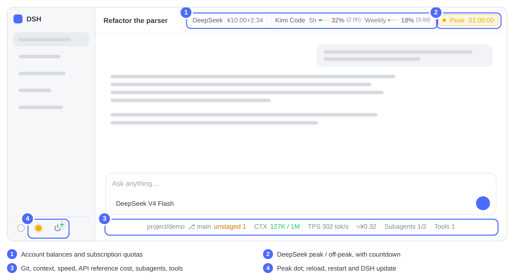
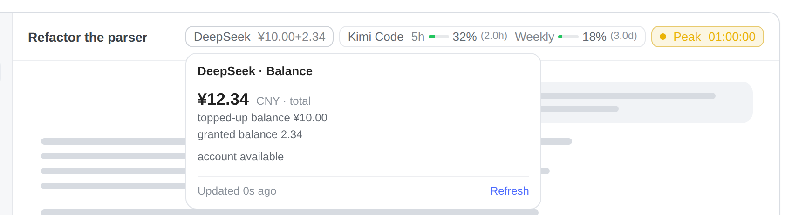
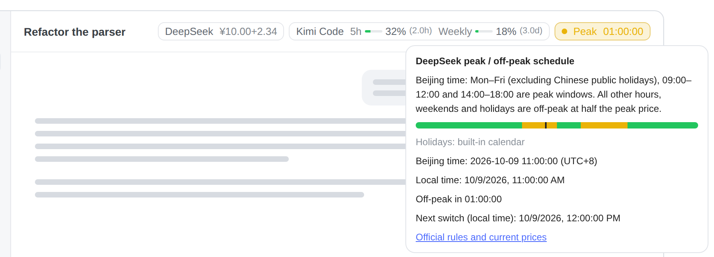
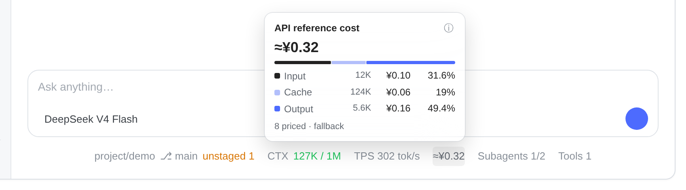
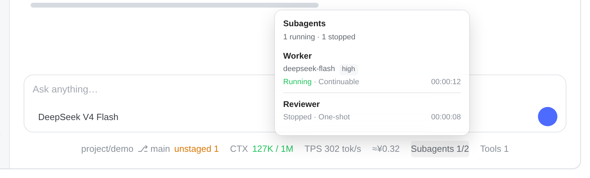
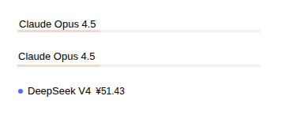
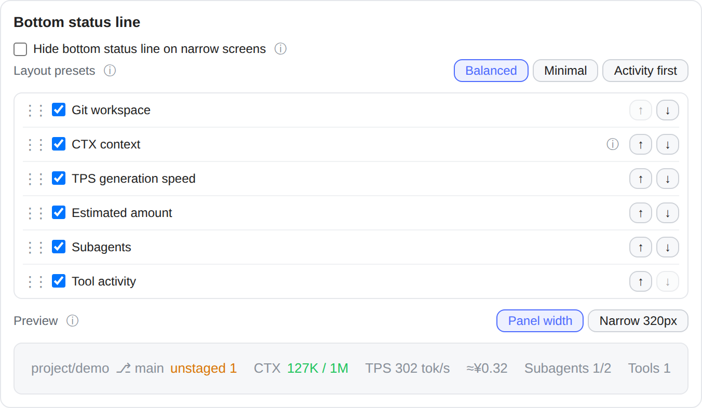
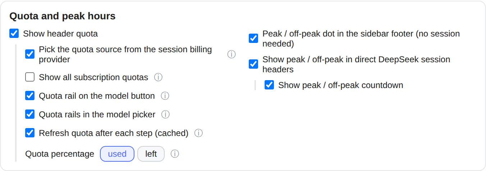
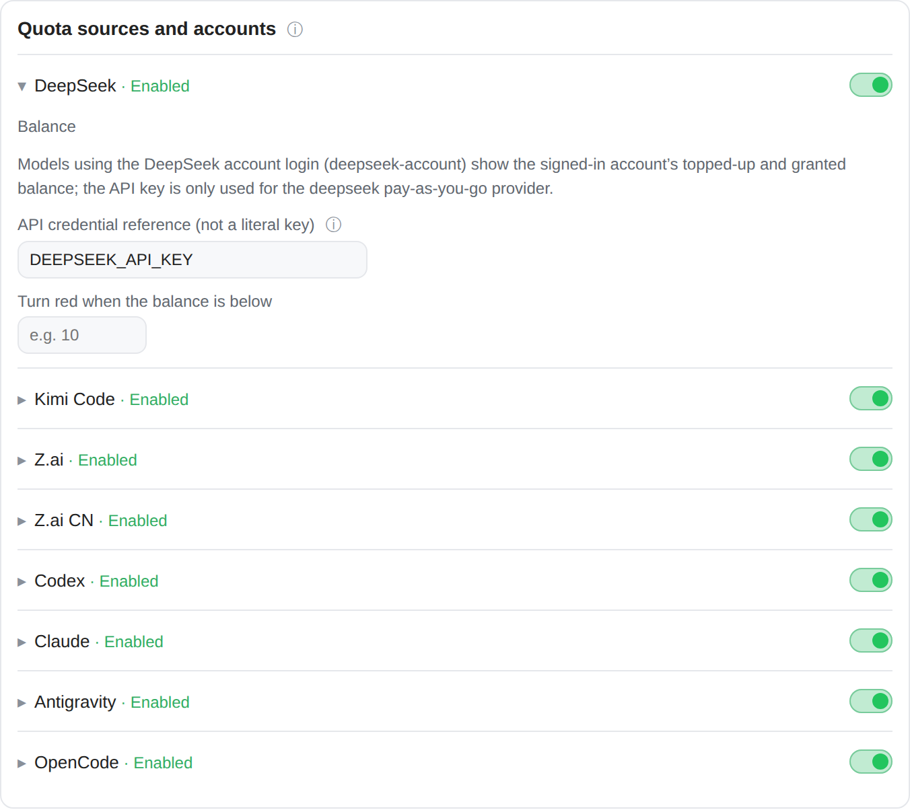

#  dsh-statusline-plus

[](https://github.com/overact/dsh-statusline-plus/releases/latest)
[](https://www.npmjs.com/package/dsh-statusline-plus)
[](https://github.com/overact/dsh-statusline-plus/actions/workflows/verify.yml)

[English](#english) | [简体中文](#简体中文)

<a id="english"></a>
A statusline for DeepSeek Harness Web (`dsh web`): account quotas and DeepSeek peak hours in the session header, Git and session metrics under the composer, and each subscription's quota on the model picker.

<p></p>

Screenshots show the real components with sample data inside a simplified DSH window. They contain no account or conversation data.

## Install

```sh
dsh plugin --profile web add dsh-statusline-plus
```

Requires DSH **0.2.0-rc.2 or later**, with no upper bound, so a DSH upgrade never disables the plugin. Tested on **0.2.0-rc.2**, **0.2.1-rc.2**, **0.2.2-rc.3** and the Windows Desktop build (**0.2.1-rc.3**).

The same release is published as a GitHub Release tarball for pinned and offline installs:

```sh
dsh plugin --profile web add https://github.com/overact/dsh-statusline-plus/releases/latest/download/dsh-statusline-plus.tgz
```

The bundle registers its own plugin row and ships prebuilt files. With HMR enabled, plugin switches and settings apply live; refresh the browser afterward. Restart DSH only when installation or an upgrade reports `restart-required`, and wait until no sessions are active. For development, install a local clone with `dsh plugin --profile web add file:/path/to/dsh-statusline-plus`; its source changes hot reload when the directory is watched.

If you installed an earlier version by hand, remove the `@local/dsh-statusline-plus` row and dependency first, so the plugin is not registered twice. Existing `statusline-plus` settings remain compatible. See the [release notes](CHANGELOG.md).

## What it shows

### 1 · Balances and quotas

Chips in the session header for DeepSeek, Kimi Code, Z.ai / Zhipu, Claude, Antigravity (shown as `Agy` to keep the header short), Codex, OpenCode Go and OpenRouter, plus any other subscription your Magpie reports. By default the chip follows the model the session uses; **Show all subscription quotas** shows every enabled source instead. Click a chip for details and a manual refresh. When Codex, Antigravity, Claude or Grok resets quota for everyone, a short notice slides out under the chip ([reset notices](docs/features/reset-alerts.md)).

<p></p>

Models on DSH's signed-in `deepseek-account` provider show that account's topped-up and granted balances through the Host, without an API key. Details: [quota](docs/features/quota/README.md), [sources](docs/features/quota/sources.md).

### 2 · DeepSeek peak hours

A peak / off-peak chip with a countdown in direct DeepSeek sessions, and a coloured dot in the sidebar footer that works without a session. The panel shows the day's timeline, Beijing and local time, and the next switch.

<p></p>

A year without a holiday calendar leaves only weekdays inside a peak window unknown; weekends and hours outside the windows are still off-peak. If the official rule wording stops matching, the known schedule still applies and the indicator warns that the rules may have changed. Details: [peak hours](docs/features/peak-hours.md).

### 3 · Session metrics under the composer

One row, in the order you choose: Git branch and changes, context usage, streaming speed (TPS), API reference cost, direct subagents, and running tools. Cost and Subagents open detail panels.

<table><tr>
<td></td>
<td></td>
</tr></table>

Groups wrap on narrow screens, and an optional switch hides the row when the input area is 480px wide or less. Details: [bottom row](docs/features/bottom-bar/README.md), with a page per component.

### Quota on the model seat

In an empty session the composer's model button carries a thin rail for the subscription that pays for the current model, so the quota shows before the header exists. Every row of the model picker shows its own subscription's rail, or the balance amount. The button and the picker rows have separate switches.

<p></p>

Details: [model seat quota rail](docs/features/model-quota-bar.md).

### 4 · Reload, restart and DSH update

The power button in the sidebar footer hot-reloads plugin and config changes without interrupting sessions, and restarts the Host only when a change needs it, asking first while a session runs. Where DSH runs as a systemd user service from a user-writable global npm install (Linux, WSL), it also offers a full restart and, when a newer DSH is published, shows a green up-arrow for the update. The update stops the Host, installs the version, updates official `@deepseek-ai/dsh-*` profile plugins within their own ranges, starts and verifies it, and rolls back a version that cannot start. Windows and the desktop apps get the reload only. Details: [restart](docs/features/restart.md).

### Plugin self-update

When npm publishes a newer version of this plugin, the settings header shows an update button naming it. One click installs it in place with the Host's `dsh plugin add` (falling back to `pnpm`), and HMR swaps it into the running profile, so a refresh is enough. A linked development checkout is never offered an update. Details: [self-update](docs/features/self-update.md).

## Settings

Open **DSH Web → Settings → Statusline**. Settings are saved under `statusline-plus` in the native profile and apply as you change them.

<p></p>

<details>
<summary>Quota, peak hours and source settings</summary>

<p></p>
<p></p>

</details>

| Setting | Default | Effect |
| --- | --- | --- |
| `enabled` | `true` | All plugin displays and refreshes |
| `hideBottomOnNarrow` | `false` | At input-area widths ≤480px, unmount this plugin's bottom row and stop its client activity; restore it when wider. Native stats remain visible |
| `showGit`, `showContext`, `showCost`, `showActivity` | `true` | Individual bottom components |
| `showTools` | `false` | Tool activity |
| `showCwd` | `true` | Repository path in the Git chip |
| `gitCwd` | `''` | Fixed repository directory for every session; empty follows the session's working directory. While set, the chip no longer follows `working_directory` |
| `showTps` | `true` | Streaming speed |
| `componentOrder` | Git, context, TPS, cost, activity, tools | Bottom component order, including items other plugins add ([docs/extending](docs/extending/README.md)) |
| `hiddenComponents` | `[]` | Ids of other plugins' bottom-row items that are switched off |
| `showQuota`, `quotaAuto`, `quotaOnStep` | `true` | Header quotas, provider selection and shared step refresh |
| `modelQuotaBar` | `true` | Quota rail on the composer's model button while the session is empty; it hides once the conversation starts and the header chip takes over |
| `modelQuotaRows` | `true` | Quota rail on every row of the model picker (a balance source shows its amount instead) |
| `showDeepseekPeak`, `deepseekPeakCountdown`, `showPeakDot` | `true` | DeepSeek peak indicators and countdown |
| `resetAlerts`, `resetAlertKinds`, `resetAlertSeconds` | `on`, Codex/Antigravity/Claude, `5` | Subscription reset notices ([docs](docs/features/reset-alerts.md)) |
| `showRestartButton` | `true` | Reload/restart/DSH-update button; off also stops the Host's DSH release check and restart route |
| `cacheTtlMs` | `60000` | Quota result reuse; UI displays seconds, effective minimum 15s |
| `fetchTimeoutMs` | `10000` | Request timeout; UI displays seconds |
| `showCodexQuota`, `showAntigravityQuota`, `showClaudeQuota`, `showOpenCodeQuota` | `true` | Allow each of those subscriptions as a quota chip. A switched-off source shows nothing, never a "not found" placeholder |
| `quotaShowAll` | `false` | Show every enabled subscription chip and other subscriptions Magpie reports, instead of selecting one from the model |
| `quotaPercentMode` | `used` | Read percentages as consumed or remaining, in chips and details alike |
| `codexQuotaOnTurn`, `antigravityQuotaOnTurn` | `true` | Legacy per-source refresh switches, read once to migrate into `quotaOnStep`; the settings page writes `quotaOnStep` |
| `quotaSources` | `{}` | Per-subscription source pin, e.g. `{ "codex": "cpa" }`, set in each source card. With none set: Magpie, then CPA, then the official tool's login file (read only, never refreshed). A pinned source has no fallback. See [sources](docs/features/quota/sources.md) |
| `codexAccount`, `antigravityAccount` | `''` | CPA account id to read that subscription from, instead of the account the tool logged in with. `''` follows the login file |
| `apiKeyEnv` | `OPENCODE_GO_API_KEY` | Credential **reference** for the OpenCode Go usage endpoint, never a literal key |
| `usageUrl` | `https://opencode.ai/zen/go/v1/usage` | Override the OpenCode Go usage endpoint; an internal host is rejected |
| `providers` | Built-in sources | Credential references, source switches, low-balance thresholds and endpoint overrides |

**Credentials.** Settings hold the names of environment variables, never keys, and keys stay on the Host. DeepSeek reuses `DEEPSEEK_API_KEY` for API-key models (`deepseek`, `deepseek-official`); Kimi uses `KIMI_API_KEY`; Z.ai and Zhipu use `ZAI_API_KEY` and `ZAI_CODING_CN_API_KEY`. Other sources use their existing Host credentials or account integrations.

**Presets and reset.** Presets change bottom components only. Reset restores display, layout and refresh preferences, and keeps credential references, account files, repository paths and per-source switches.

## Limits

- **Quota refresh.** Results are cached; expiry alone never polls. A network failure retries at most three times (after 15/30/60 s), a rate limit after 60/120/240 s. Going offline pauses recovery; coming online, a visible page, a new step or a manual refresh starts a fresh cycle. Earlier data stays visible during retries; credential and invalid-response errors wait for a fix. Requests use a plugin-owned connection pool with a 5-second connect window, bounded by the request timeout (Codex: 15 s), and leave the Host's network defaults unchanged. Unknown values stay unknown, never zero.
- **Model seat.** The rail reads the same source as the header chip: the window that blocks first, one subscription per model, and a balance amount instead of a proportion. Picker rows ask once per subscription.
- **Cost** is an estimate from actual usage and the vendor's public API prices, including cache rates where known, with one tariff per request. Subscriptions use the same reference prices. Pricing matches the model ID after the final `/`; DeepSeek plan, snapshot and tier spellings fold to the standard Flash/Pro card, and other unknown models stay unpriced. USD and CNY are kept separate. It excludes child sessions, inherited fork history and extra fees, and is not an account charge.
- **Context.** The CTX panel counts requests that had prompt input but no cache read. It is a request count, not tokens; a provider that never reports cache makes every request count.
- **Git.** Nothing shows outside a repository. When Git cannot read one, the chip shows `⎇ ?` with the reason in its tooltip, and a click retries; the plugin never changes Git config. With too many untracked files the untracked count reads `??` and the rest still shows.
- **Speed and activity.** TPS distinguishes character estimates from settled output-token rates, and is measured only while a page watches the session. Tool durations include approval and waiting. Subagents shows direct children; stopped does not imply success. External children (Claude Code, Codex) take their state from the parent's settlement record.
- **Schedules.** Provider APIs and price catalogs can change. DeepSeek's calendar has a built-in 2025–2026 fallback, and a fetched holiday-cn calendar wins where published. The official pricing page is only a change detector.

## Development

```sh
npm run verify -- --files lib/client.js --ui responsive
npm run verify -- --files lib/client.js --style-only --ui subagents
npm run verify:all
npm run screenshots          # regenerates docs/images from sample data
```

Pass the files you changed. `--ui` picks a browser panel (`cost`, `subagents`, `chip`, `magpie-accounts`, `mobile`, `modelbar`, `restart`, `responsive`, or `none`), `--style-only` is for CSS-only edits, and `--plan` previews the selection. Run `verify:all` once at the end. `npm run check` and `npm test` are also available; `DSH_PACKAGE_DIR` selects an installed DSH runtime for integration tests.

```sh
npm run dev:runtime        # does the active profile HMR-watch this checkout's lib/?
npm run release:preflight  # before tagging: metadata, pushed clean main, CI browser checks on HEAD
npm run release:check      # version, README badge, CHANGELOG, tag, npm dist-tag, assets and latest
```

`dev:runtime` reads the active profile's `cordis.patch.yml` (`DSH_PROFILE_DIR` overrides `~/.dsh/profiles/web`); run it before advising a restart. Pushing a `v*` tag runs the full verification and publishes to npm and GitHub Releases; see [releasing](docs/development/releasing.md). Per-feature design notes, including quota protocols, start at [docs/README.md](docs/README.md); read the page for an area before changing it.

Browser checks use real React and the client bundle with offline fixtures. Install the tooling only if missing:

```sh
npm run ui:install
node tools/ui/node_modules/playwright/cli.js install chromium
npm run verify:ui -- --panel responsive
```

The runner uses installed Chrome or Playwright Chromium (`PLAYWRIGHT_CHROMIUM_EXECUTABLE_PATH` overrides it); reports go to the ignored `output/playwright/`. An optional authorized, read-only live check needs an existing session: `npm run verify:ui -- --live --session SESSION_ID --panel all`. It opens the cost and Subagents panels without changing settings, sending prompts or restarting DSH; authentication is redacted.

<a id="简体中文"></a>
## 简体中文

DSH 网页端（`dsh web`）状态行：会话顶栏显示账号余额、套餐额度与 DeepSeek 峰谷时段，输入框下方显示 Git 与会话指标，模型选择器里每个模型带上各自套餐的额度。

截图为真实组件 + 演示数据，放在简化的 DSH 窗口里，使用英文界面，不含真实账号或对话数据。总览图见页首：① 顶栏额度，② 峰谷芯片，③ 输入框下方的状态行，④ 侧栏底部的峰谷圆点与重载／更新按钮。

### 安装

```sh
dsh plugin --profile web add dsh-statusline-plus
```

需要 DSH 0.2.0-rc.2 或更高版本，不设上限，升级 DSH 不会让插件被跳过；已在 0.2.0-rc.2、0.2.1-rc.2、0.2.2-rc.3 与 Windows 桌面版（0.2.1-rc.3）上测试。也可以用上文的 GitHub Release 安装包固定版本或离线安装。插件自带预构建文件和注册配置；启用 HMR 后，插件启停与设置实时生效，刷新浏览器即可。安装或升级提示 `restart-required` 时，才需等待无活跃会话后重启。旧版手动安装请先移除 `@local/dsh-statusline-plus` 注册行和依赖，避免重复注册。

### 功能

**① 余额与额度。** 顶栏芯片支持 DeepSeek、Kimi Code、Z.ai／智谱、Claude、Antigravity（顶栏显示为 `Agy` 以节省空间）、Codex、OpenCode Go、OpenRouter，以及 Magpie 报告的其他订阅。默认只显示当前模型对应的来源，开启“显示全部订阅额度”可全部显示。点击芯片查看详情并手动刷新。Codex、Antigravity、Claude、Grok 全员重置额度时，芯片下方会滑出简短提醒。使用 DSH 登录账号（`deepseek-account`）的模型，通过宿主读取该账号的充值余额与赠送余额，不需要 API Key。

<p></p>

**② DeepSeek 峰谷时段。** 直连 DeepSeek 的会话顶栏显示峰谷状态与倒计时；侧栏底部的圆点不需要会话也能看。面板列出当天时间轴、北京时间与本地时间、下一次切换。没有日历覆盖的年份，只有“峰段窗口内的工作日”保持未知；官方规则措辞不再匹配时，仍按已有时段判断，并提示“规则可能已变更”。

<p></p>

**③ 输入框下方的状态行。** 按你设定的顺序显示 Git 分支与改动、上下文用量、生成速度（TPS）、API 参考金额、直接子代理和正在运行的工具；金额与子代理可展开详情。窄屏时自动换行，也可开启“窄屏时隐藏底部状态行”（输入区域 ≤480px 时隐藏）。

<table><tr>
<td></td>
<td></td>
</tr></table>

**模型选择处的额度。** 空会话里，输入框的模型按钮底部有一条细额度条，对应当前模型所用的订阅，顶栏还没出现时就能看到额度；模型列表的每一行显示各自订阅的额度条，余额类来源直接显示金额。按钮与列表各有开关。

<p></p>

**④ 重新加载、重启与 DSH 更新。** 侧栏左下角的电源按钮先热重载插件与配置改动，会话不中断；只有改动必须重启时才重启宿主，有会话在运行时先询问。DSH 以 systemd 用户服务运行、且来自当前用户可写的 npm 全局安装（Linux、WSL）时，还提供“完全重启”；有新版 DSH 时按钮出现绿色上箭头，可一键更新：停服务、安装、在各自允许的范围内升级官方 `@deepseek-ai/dsh-*` 插件、启动并验证，新版本起不来会自动回滚。Windows 和桌面版只有热重载。

**插件自更新。** npm 上有新版本时，设置页右上角出现更新按钮；点一次即用宿主自带的 `dsh plugin add`（其次 `pnpm`）原地安装，HMR 换入后刷新页面即可。`link:` 安装的本地副本不显示。

### 设置

打开 **DSH 网页端 → 设置 → 状态栏**，调整显示、排序、预设、顶栏额度、账号来源及缓存；截图与完整选项表见上文 [Settings](#settings)。设置里只填写凭据引用（环境变量名），密钥只在宿主侧解析。DeepSeek 有两种计费方式：`deepseek`／`deepseek-official` 使用 `DEEPSEEK_API_KEY` 查询按量余额；`deepseek-account` 读取登录账号余额，不需要 API Key。预设只改底部组件；恢复默认会保留凭据引用、账号、仓库路径和各来源开关。

### 说明

- **额度刷新：** 结果有缓存，到期本身不会轮询。网络失败最多自动重试 3 次（15／30／60 秒），限流等待 60／120／240 秒；断网暂停，网络恢复、页面重新可见、新步骤或手动刷新会开启新一轮。重试期间保留已有数据；凭据与响应格式错误不自动重试。未知值不显示成零。
- **费用：** 按实际用量与厂商公开 API 单价估算，每个请求只用一种费率，不代表实际扣款，不含子代理与额外费用；人民币和美元分别累计。DeepSeek 的套餐、快照与订阅价档写法归一到标准 Flash/Pro 价格，其他未知模型不估价。
- **上下文：** CTX 面板在“缓存读取”后显示未命中缓存的请求数；这是请求数，不是 token 数。
- **Git：** 不在仓库内时不显示；git 无法读取仓库时显示 `⎇ ?`，悬停看原因，点击重试，插件不会修改 git 配置；未跟踪文件过多时未跟踪数显示 `??`。
- **速度与活动：** TPS 只在有页面查看该会话时计算；工具耗时包含审批与等待；子代理停止不等于成功。

开发与验证命令见上文 [Development](#development)。

[MIT License](LICENSE)
