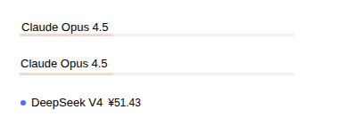

# Model seat quota rail

The header chip only exists once a session has started. Before the first message
there is no header, so the composer's model button carries the same reading: a 3px
rail along its bottom edge, tinted by the subscription that pays for the model. The
model picker shows the same rail on every row, so choosing a model also shows what
each subscription has left.

## Code

| Part | Location |
| --- | --- |
| Slot registration | `apply()` in `lib/client.js`, `conversation.input.model.label` |
| Component | `ModelQuotaLabel`, `modelBadgeNode`, `resolveBadgeText` |
| Model → subscription | `modelQuotaSource`, `quotaKindEnabled` |
| Rail geometry | `modelQuotaMeter`, `meterPaint`, `applyModelRail`, `clearModelRail` |
| Shared fetch | `modelQuotaStore`, `useModelQuota` |
| Empty-session signal | `setComposerStarted`, `useComposerStarted` (set by `StatusPanel`) |
| Colours | `planColor`, `planKeyOf` |
| Host slot | declared by `@deepseek-ai/dsh-client-ui-model-selection` |

## Where it appears

`conversation.input.model.label` is the Host's own label slot, rendered inside the
model button and inside every picker row. The Host passes
`{ provider, model, placement, selected }`; `placement` is `trigger`, `menu` (the
picker's "Model" cell) or `option` (one row).

The subscription is resolved by `modelQuotaSource`, the same function the header chip
uses ([quota/README.md](quota/README.md#which-chip-appears)), so the two surfaces
cannot disagree about which source pays for a model.

| Placement | Rail | Extra |
| --- | --- | --- |
| `trigger` | Only while the session is empty | A balance source adds its amount |
| `option` | Always (when the subscription is known) | A balance source shows its amount instead |
| `menu` | Never | — |

**Empty session only.** The Host mounts `conversation.composer.dock` only when
`variant === "composer"`, and a blank session renders as `hero`. `StatusPanel`
therefore reports its own mount through `setComposerStarted`; the button drops its
rail as soon as the dock mounts, while the picker rows keep theirs. This is a public
slot, not a DOM guess, so it survives markup changes. Under a Host that never mounts
the dock, the button keeps its rail — the degradation is a visible rail, not a crash.

## Geometry

The rail is 3px tall, inset 6px from the button's left and right edges, and sits 3px
above the bottom edge. The track stays visible at 10% of
`--dsw-alias-label-tertiary`; without it a tint that stops mid-name reads as a
highlight, not a proportion. A full-width background fill was rejected for the same
reason: the button shrink-wraps to its text, so the "track" would change length with
the model name. Rows use the same geometry, inset 7px to match their padding.

## What one rail means

One subscription can report several windows. The rail shows the window that will
block you first: the highest `usedPercent` among the windows the header chip would
show (`chipWindowsOf`). Exhausting any window blocks the subscription, so a
second bar would not change the answer. Every window and its reset countdown is in
the tooltip.

`quotaPercentMode` applies: `used` fills as quota is spent, `left` fills with what
remains. Colour is identity, not health — except an exhausted window, which turns the
whole rail to the error tint.

**A balance has no denominator**, so it never paints a proportion. It shows its
amount (e.g. `¥51.43`); only `isAvailable === false` or a remaining below `redBelow`
turns the rail into a full error stripe, which reads as "this is spent" rather than
"this is 100% used".

## Colours

`planColor` maps a subscription to a token mix, so both themes adapt and no hex is
invented:

| Source | Tint |
| --- | --- |
| Codex | `--dsw-alias-state-success-primary` |
| Claude | error 55% + warn 45% |
| Antigravity | business 55% + error 45% |
| OpenCode | success 45% + business 55% |
| DeepSeek (provider or account) | `--dsw-alias-brand-primary` |
| Kimi Code | business 45% + error 55% |
| Z.ai / Zhipu | `--dsw-alias-state-warn-primary` |
| OpenRouter | `--dsw-alias-label-tertiary` |
| Anything else | `--dsw-alias-label-secondary` |

The fill is 15% of that colour; the track is 10% of `--dsw-alias-label-tertiary`.

## Requests

`modelQuotaStore` keeps one result per subscription key (`provider:<id>`, `codex`,
`claude`, `antigravity`, `opencode`, `magpie:<id>`), so four Claude models in the
picker are one request. The store answers from cache for `max(15000, cacheTtlMs)`
and backs off 15 s after an error (60 s for `rate-limit`), staying behind the Host's
own error cache. Rows fetch when the picker opens; the button fetches on mount. Agent steps do not
invalidate the store: re-rendering the picker inside the cache window asks nothing, and
a failed entry keeps its backoff. Notifications are per subscription key, so one
subscription's answer repaints only the rows that use it; `ModelQuotaLabel` is memoized
against the Host's streamed-step re-renders. A failed read retries on the next focus or
reconnect, and the store's cache and backoff still apply, so this cannot become a poll.

This is deliberately a second, small cache beside `useQuotaResource`: the chip needs
per-session keys and a retry ladder with a countdown, while the rail needs one shared
answer per subscription. The chip's step refresh is cache-gated too (see
[quota/README.md](quota/README.md#refresh)); the rail never refreshes on an agent step. Merging them is possible but would put the chip's retry UI
behind the store's simpler policy; the duplication is 40 lines and bounded.

## Settings

`modelQuotaBar` (button rail, default on) and `modelQuotaRows` (picker rows, default
on) are in the Header group of the settings page and in `RESET_KEYS`.

## Pitfalls

- **Hover clears a stylesheet rail.** The Host's `._trigger:hover` sets the
  `background` shorthand, which resets `background-image`; a rule of ours loses on
  specificity. The rail is written as inline background layers, which win, and the
  hover colour still shows through the transparent part. Verified in
  `verify-ui --panel modelbar`.
- **The slot is `single`.** Registering it replaces the Host's fallback label, so
  `ModelQuotaLabel` reproduces `model.name` and the optional `Tag` badge
  (`Primitives.Tag`, plain span when the Host lacks it). A future Host registration
  would win by being first; the plugin then simply stops decorating.
- **The rail is written on the Host's button.** Only `data-slp-model-rail` and the
  four background properties are touched, and they are cleared on unmount. No layout,
  colour or size is changed.
- **A balance never gets a ratio.** Do not "normalise" it against `redBelow` or a
  guessed budget: a full bar would claim a denominator the service never reported.
- **Rows are per model, not per provider.** Two models on the same subscription show
  the same rail from one cached result; do not key the store by model.
- **Wheel scrolling does not fire `mousemove`.** The Host highlights a model row from
  the row's `onMouseMove` and deliberately has no `:hover` rule on model rows. Scrolling
  moves a different row under a stationary pointer without firing the event, so the
  old row keeps the highlight until the pointer moves. `bindModelMenuScroll` attaches
  one passive bridge per menu and, after a wheel-driven scroll, re-dispatches a standard
  `mousemove` on the button under the pointer; the Host remains the only writer of its
  highlight/focus state. It never prevents the wheel. Verified by the scroll list in
  `verify-ui --panel modelbar`.

## Tests

`tests/client-lifecycle.test.js` covers source resolution, the window choice, the
balance branch and the tooltip. `scripts/verify-ui.mjs --panel modelbar` mounts the
label in Host-shaped buttons and asserts the 3px rail, survival across hover, the
balance row, the empty-session rule and that the active row follows a wheel scroll under a
stationary pointer.
